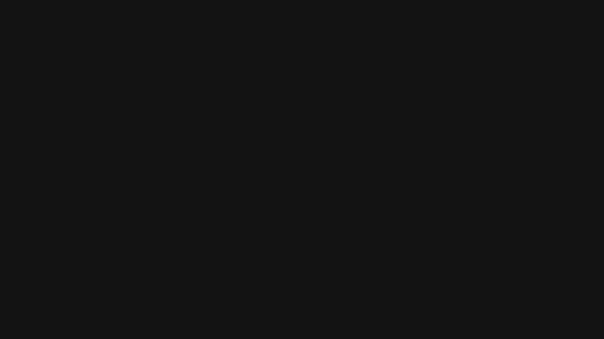

# openlabel

[](https://openlabel-two.vercel.app)

Open tools that keep every message to a doctor true to the FDA label.

- **Check** matches each claim in a piece, including what its imagery implies, to the label sentence that supports it.
- **Watch** turns a label revision into the list of approved claims it broke.
- **Unseen** finds no-see and low-see doctors from public data (NPPES, CMS Part D, Open Payments, ClinicalTrials.gov).
- **Skills** packages medical affairs agent skills, each with its eval suite.

All four work today. See `docs/plan.md` for how they fit together. Lorvexa, the drug on the site, is fictional, and the site's figures are illustrative.

## Check a piece

Check needs a model key, read from a `.env` file in the working directory or the environment. Claude (`ANTHROPIC_API_KEY`) is the default; OpenAI, OpenRouter, Gemini, Groq and a local Ollama work too with `--provider` and `--model`. See [Models and providers](https://au-2a4a5dc8.mintlify.app/cli/overview#models-and-providers).

```sh
npm install
npx openlabel check examples/dupixent-email.html --label dupixent
npx openlabel check examples/dupixent-sms.txt --label dupixent --rules examples/pulse-sms.yaml
npx openlabel check examples/dupixent-email.html --label dupixent --json
```

Run it with [Bun](https://bun.sh) at a terminal (`bun packages/cli/src/main.ts check …`) to get a full-screen, keyboard-driven view built with OpenTUI instead of plain text; `--plain` turns it off.

It fetches the current label from DailyMed, pulls every claim out of the piece, finds the label sentences each one could rest on, and asks Claude for a verdict that must cite one of them. Rule packs are YAML and run without a model.

Exit codes: 0 when every claim is supported, 1 for overstated claims or warnings, 2 for off-label or unsupported claims or rule violations, 64 for usage errors, 69 when the check could not run.

## Watch a library

Save each approved piece's check next to it, then run `watch` on the folder whenever you like. It diffs the label each piece was checked against with today's label and lists every claim that rested on a sentence that changed.

```sh
npx openlabel check approved/email.html --label dupixent --save
npx openlabel watch approved
```

`watch` exits 0 when nothing in the folder is affected and 1 when something is, so it can run on a schedule in CI. Inserting a table renumbers every later table; the diff ignores that.

## Find doctors nobody calls on

```sh
npx openlabel unseen "Georgia dermatologists prescribing dupilumab with under \$100 in industry payments"
npx openlabel unseen --state MS --specialty Endocrinology --drug Semaglutide --drug Tirzepatide --max-payments 1000
```

Unseen ranks a specialty's Medicare Part D prescribers of a drug in one state, keeps those whose Open Payments total for 2023 to 2025 is under the limit, and adds their NPPES practice location and any ClinicalTrials.gov site that carries their name. A question in plain language is turned into that search by Claude; the flags skip the model entirely.

Part D 2024 is the newest prescribing year CMS has published, so it runs about two years behind. Part D has no diagnoses and no infused drugs billed under Part B, and ClinicalTrials.gov has no NPIs, so trial matches are leads to check.

## Read a label

```sh
npx openlabel search dupixent "conjunctivitis and keratitis"
npx openlabel diff dupixent --from 53
```

`search` prints the label sentences that best match a question, with citations. `diff` prints every sentence that changed between two label versions, defaulting to the current one and the one before it.

## Skills

The repo is a Claude Code plugin marketplace with one plugin, `openlabel-skills`:

```sh
claude plugin marketplace add amanibobo/openlabel
claude plugin install openlabel-skills@openlabel
```

| Skill | What it does |
| --- | --- |
| `claim-check` | Checks copy against the label and explains each verdict with a rewrite |
| `label-diff` | Summarizes a label change and what it means for approved content |
| `fair-balance` | Weighs risk prominence against benefit claims and drafts risk language from the label |
| `hcp-sms` | Writes 160-character variants of approved copy and checks each one |
| `med-info-response` | Drafts a response to an unsolicited HCP question, cited to the label |

The skills call the `openlabel` command, so link it first with `npm link -w openlabel`. Each skill ships its eval suite in `evals.yaml`, run with:

```sh
npx openlabel skills eval                 # every skill
npx openlabel skills eval hcp-sms --case no-link-given
```

The runner gives Claude the skill and the openlabel commands as tools, runs each case against real labels, and grades the reply with text checks and, where text cannot decide, a Claude judge.

## Run the site

```sh
npm run dev
```

## The terminal demo

The hero video is a real [OpenTUI](https://opentui.com) app in `tui/`, recorded through xterm.js.

```sh
cd tui
bun install
bun run demo     # play it in your terminal
bun run record   # regenerate apps/web/public/demo/check.{mp4,webm} and the poster
bun run gif      # regenerate docs/media/demo.gif for this README from the mp4
```

## Layout

- `packages/label` fetches labels from DailyMed and parses them into numbered sections and citable sentences.
- `packages/check` extracts and judges claims and runs rule packs.
- `packages/watch` diffs label versions and finds the saved claims a change touches.
- `packages/unseen` joins CMS Part D, Open Payments, NPPES and ClinicalTrials.gov on NPI.
- `packages/skills` runs the skills' eval suites.
- `packages/cli` is the `openlabel` command.
- `plugin` is the Claude Code plugin; `.claude-plugin/marketplace.json` lists it.
- `apps/docs` is the documentation, built with [Mintlify](https://mintlify.com). Preview it with `npm run docs`.
- `apps/web` is the site. `app/content.ts` holds its copy and example data, and `app/geo.ts` projects county maps from `us-atlas` at build time.
- `apps/web/assets-src/lorvexa-ad.html` is the source of `apps/web/public/images/lorvexa-ad.png`. The photo is by [Erik Allen on Pexels](https://www.pexels.com/photo/2589840/).
